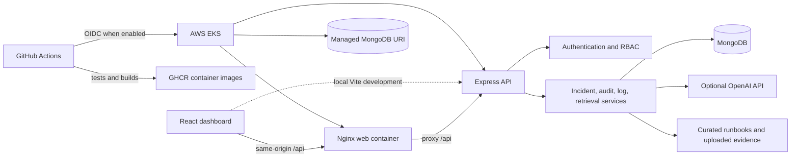

# TraceMind architecture

## Request flow

The browser sends credentialed requests to the Express API. Local Vite development uses `http://localhost:4000/api`; the container and Kubernetes web servers proxy same-origin `/api` paths to Express. Express validates inputs, authenticates the session cookie, applies role checks and rate limits, and calls service modules. Mongoose stores incidents, parsed log entries, audit records, and embedded knowledge chunks in MongoDB.

Log uploads are streamed and size limited. Stored lines are redacted before persistence; external model prompts receive additional secret and PII redaction. Retrieval uses JavaScript embedding vectors and cosine scoring when an OpenAI key is available and keyword ranking otherwise. Returned citations are restricted to supplied source IDs and source ranges. The AI may suggest read-only checks; a person must approve any remediation.

## Runtime boundaries

- **React/Vite:** dashboard, login, investigation chat, log views, charts, exports.
- **Express:** REST routes, validation, auth, authorization, rate limits, audit logging, and readiness/health reporting.
- **MongoDB:** durable application records; demo mode is an explicit local fallback only.
- **OpenAI:** optional chat, log analysis, and embeddings; provider failures fall back to local analysis/retrieval.
- **Docker/Kubernetes:** separate API and web images; Kubernetes expects an externally managed MongoDB-compatible database and secret values.
- **GitHub Actions:** CI validates code and Docker builds. Main-branch images publish to GHCR; EKS rollout is gated on AWS OIDC configuration.
